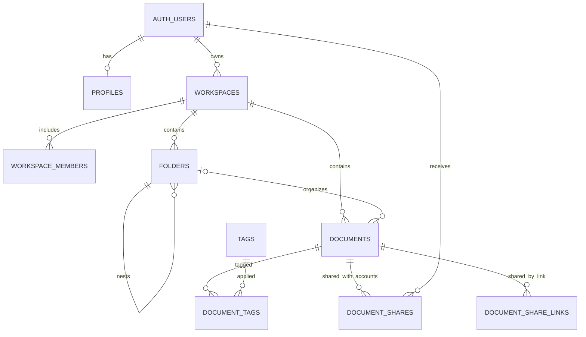

# Mộc — Personal Knowledge Platform

Private, multi-user documentation workspace. Authentication, document management/editor, optimized paginated search, per-document Markdown/JSON exports, and expiring/revocable read-only share links are implemented.

## Stack

- Next.js App Router, React, TypeScript strict mode, Tailwind CSS
- Supabase Auth and PostgreSQL with Row Level Security
- Tiptap rich text editor with JSONB content and Markdown/plain-text derivation
- Zod for input validation

The application uses the Supabase publishable/anon key in the browser and server. There is no service-role key in the application.

## Local setup

1. Install Node.js 20.9 or newer and npm.
2. Install dependencies with `npm install`.
3. Create a Supabase project and copy `.env.example` to `.env.local`.
4. Set `NEXT_PUBLIC_SUPABASE_URL` and `NEXT_PUBLIC_SUPABASE_ANON_KEY` from Supabase project API settings.
5. Apply `supabase/migrations/202611200001_initial_schema.sql` using the Supabase SQL editor or Supabase CLI.
6. In Supabase Auth, enable email/password and configure the site URL plus allowed redirect URL `http://localhost:3000/auth/callback`.
7. Apply `supabase/migrations/202611200002_document_search.sql` after the initial schema migration.
8. Apply `supabase/migrations/202611200003_search_optimization_and_sharing.sql` for lower-latency search indexes and secure share links.
9. Apply `supabase/migrations/202611200004_registered_document_shares.sql` for account-to-account viewer access.
10. Apply `supabase/migrations/202611200005_document_tag_management.sql` to enable editing document tags.
11. Apply `supabase/migrations/202611200006_private_document_images.sql` to enable private image uploads and document-scoped image access.
12. Apply `supabase/migrations/202611210001_share_scoped_document_images.sql` to scope public-link image reads to the exact active share link.
13. Start with `npm run dev`.

Email confirmation is currently disabled for the connected Supabase project for signup testing. Re-enable **Confirm email** in Supabase Auth before production use. Set the production redirect URL in Supabase before deployment. Password recovery redirects through `/auth/callback` to `/reset-password/update`.

## Foundation schema

`profiles` is keyed to `auth.users`. A database trigger creates a profile and a personal workspace for new accounts. `folders`, `documents`, `tags`, and `document_tags` are workspace-scoped. Owners can create/revoke read-only document links or grant/revoke viewer access for registered accounts. Shared documents are readable through RLS; all writes remain owner-only.

## Current scope and next work

Implemented: app foundation, email/password signup and login, email verification callback, password recovery, session refresh, private home route, initial schema and owner-only RLS, personal workspace dashboard, folders, document create/edit, autosave, favorites, archive and trash/restore, paginated search across titles/content/folders/tags, document tag editing, private image uploads in the rich text editor, per-document Markdown/JSON exports, a workspace JSON backup, revocable read-only share links, and registered-account viewer access. The latest search indexes/link sharing require migration `202611200003_search_optimization_and_sharing.sql`; direct user sharing requires migration `202611200004_registered_document_shares.sql`; tag editing requires migration `202611200005_document_tag_management.sql`; private image uploads require migration `202611200006_private_document_images.sql`; exact-link image authorization requires migration `202611210001_share_scoped_document_images.sql`.

Documents are private to their owner unless shared. Link tokens are generated with cryptographic randomness, only SHA-256 hashes are stored, and the public read path checks revoked/expired links in the database. Registered account shares grant viewer access through authorization-checked, read-only database functions; all document mutations remain owner-only under RLS. Recipients see only the shared document content and title. Rich text is stored in `content_json`; Markdown and searchable plain text are updated by the server when the editor saves. Images are stored in a private Supabase Storage bucket, limited to JPG/PNG/WebP/GIF at 5 MB each. Image proxy routes verify access to the document and that the image path belongs to its content; newly created public links use link-scoped image copies so revoked or expired links cannot reuse another active link's image access. Older links keep their legacy image paths until they are revoked or expire. Image binaries are not included in JSON or workspace backups. Search begins after a short typing pause and shows navigation progress; the migration adds trigram indexes on the normalized search expressions. The dashboard list caps at 100 items; search returns 20 ranked results per page. Document tags are replaced atomically by a permission-checked database function, keeping failed edits from leaving a partially updated tag set. Document export downloads Markdown or JSON; workspace backup downloads all workspace documents (including trash), folders, tags, and tag relationships as JSON, fetched in indexed batches and returned with private no-store headers. ZIP backup includes the complete workspace JSON export and per-document Markdown copies. Email notifications remain a later phase.

### Phase 2 verification checklist

1. Configure Supabase using `.env.example` and apply the migration.
2. Create a user through `/signup`, verify the email, then sign in.
3. From `/app`, create a folder and document; edit content and wait for “All changes saved”.
4. Confirm favorite, archive, trash and restore actions in the dashboard.
5. Create a second account and verify it cannot read the first user's documents (RLS).
